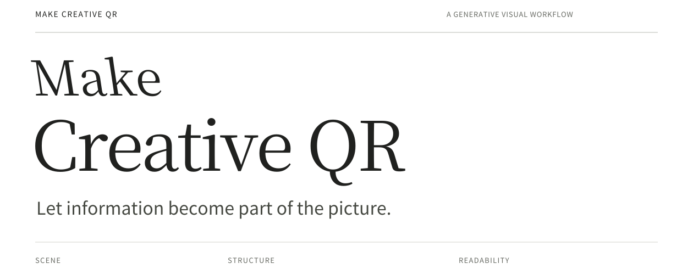
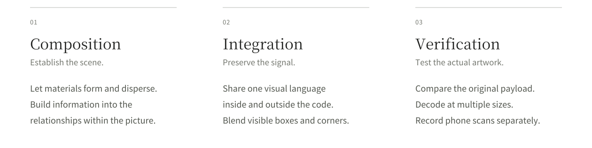

**English** | [简体中文](README.zh-CN.md)



**A workflow for turning real QR content into part of an artwork.**

Make Creative QR brings together material composition, information mapping and decoding feedback. Its core Skill defines the capabilities and acceptance criteria; the agent chooses tools available in its own environment. Encoded information becomes part of how a scene forms, while checks on the actual finished image establish readability.

Materials have an origin, density follows an idea, and the scene makes sense on its own. Photography, illustration, anime, geometry and collage can all carry information.

## Creative examples

Refracted light becomes a jellyfish. Jaguar spots take flight as a butterfly. A zipper opens onto a glowing city. Eight selected works across different styles; click any image for its story and complete original.

<table>
  <tr>
    <td width="50%" align="center" valign="top">
      <a href="examples/README.md#caustic-jelly"></a><br>
      <a href="examples/README.md#caustic-jelly"><strong>Jellyfish of light</strong></a>
    </td>
    <td width="50%" align="center" valign="top">
      <a href="examples/README.md#jaguar-butterfly"></a><br>
      <a href="examples/README.md#jaguar-butterfly"><strong>Jaguar butterfly</strong></a>
    </td>
  </tr>
  <tr>
    <td width="50%" align="center" valign="top">
      <a href="examples/README.md#zipper-city"></a><br>
      <a href="examples/README.md#zipper-city"><strong>Zipper city</strong></a>
    </td>
    <td width="50%" align="center" valign="top">
      <a href="examples/README.md#stamp-sea"></a><br>
      <a href="examples/README.md#stamp-sea"><strong>A sea in a stamp</strong></a>
    </td>
  </tr>
  <tr>
    <td width="50%" align="center" valign="top">
      <a href="examples/README.md#shaved-night"></a><br>
      <a href="examples/README.md#shaved-night"><strong>Shavings of night</strong></a>
    </td>
    <td width="50%" align="center" valign="top">
      <a href="examples/README.md#pencil-whale"></a><br>
      <a href="examples/README.md#pencil-whale"><strong>A whale's shadow</strong></a>
    </td>
  </tr>
  <tr>
    <td width="50%" align="center" valign="top">
      <a href="examples/README.md#rain-letter"></a><br>
      <a href="examples/README.md#rain-letter"><strong>Rain writes back</strong></a>
    </td>
    <td width="50%" align="center" valign="top">
      <a href="examples/README.md#flying-score"></a><br>
      <a href="examples/README.md#flying-score"><strong>The score takes flight</strong></a>
    </td>
  </tr>
</table>

[Explore all 14 examples →](examples/README.md) · [Files and verification records](examples/verification.json)

Each published file and its six sharing variants passed software decoding checks and points to this repository. Phone scan evidence is listed separately for each artwork; untested images remain pending phone review.

[New: Rain writes a letter to a paper boat →](examples/README.md#rain-letter)

## Design principles



A natural result depends on continuous material relationships inside and outside the encoded area. Preserve the functional signal while integrating visible locator squares, three distinctive corner symbols and abrupt boundaries. New works should change the formation process and distribution so each has its own visual logic.

## From payload to scene

**Define intent → lock the payload → map information → create the image → review and verify**

Before the first creation, confirm style, elements and intended use. Original bytes establish the encoding baseline; material behavior shapes the composition; an information guide constrains position and tonal separation. Capability mapping connects image access, decoding, guide construction, editing, export and verification to tools actually available in the host. Visual review and decoding results drive revisions.

<details>
<summary><strong>Technical structure and execution boundaries</strong></summary>

- **Content fidelity:** compare decoded bytes with the original payload. Do not rewrite, shorten or replace it without authorization.
- **Information guidance:** use the host's encoding, layer, mask, node or other capabilities to retain the content and required functional information.
- **Decoding feedback:** run real decoders, record individual matches and conflicts, and cross-check with independent implementations when available.
- **File integrity:** bind evidence to a content digest, file hash or host-guaranteed immutable asset version. Recheck after editing or exporting again.

The bundled Python/Node scripts are one optional implementation, using Segno, ZXing-C++, WeChatCV and SHA-256. Other hosts can use tools that achieve equivalent results.

This is a creation and acceptance protocol; outputs require iteration. Non-ASCII or binary payloads need reliable original-byte evidence. Do not generate replacement encoding when the input content cannot be confirmed.

</details>

## Readability is a delivery requirement

Natural appearance and exact content must both hold. Verify the actual complete artwork. A readable guide, successful crop or single passing size cannot qualify the final image.

The default phone-sharing profile has **seven software checks**: the actual complete file, plus PNG and quality-85 JPEG variants at widths of 480, 640 and 800 pixels. Every item must decode to the original content without conflicts. Record software results and phone scans separately; a failed phone scan sends the work back for revision.

<details>
<summary><strong>Full verification requirements</strong></summary>

- At least one decoder must recover the exact original bytes from the complete file and each required variant.
- Do not upscale the actual file to meet the test width, or remove required tests after failures.
- Crops, supplied corner coordinates and pure-code mode do not qualify an artwork.
- Use available tools for individual checks and final file identity review. In the bundled implementation, these are `qualify` and `check_delivery.py`.
- A software library or recognition API cannot substitute for a phone app scan.
- Label images without phone evidence as pending phone review. Editing a software report cannot establish a phone scan.
- Display size, compression, glare, camera distance and scanning app affect results.

</details>

## Start a creation

Upload a real QR image and invoke the Skill:

```text
Use $make-creative-qr to create an artwork with a naturally integrated QR code.
First confirm my preferred style, elements and intended use, then design
how the materials form the scene. Preserve the original scanned content
and verify both the appearance and decoding of the complete final image.
```

Documentation defaults to English, with a complete [Chinese Skill translation](skills/make-creative-qr/SKILL.zh-CN.md). Follow the user's language when discussing and delivering work; English documentation does not require English conversation.

<details>
<summary><strong>Installation and required capabilities</strong></summary>

Provide `SKILL.md` or the complete Skill directory to an agent that can read these instructions. The core protocol is self-contained. Tool calls follow the host's format and permissions; references and scripts are used as needed.

The host needs image viewing and creation, reliable decoding, required exports and verification. If real decoding or required exports are unavailable, it can produce design candidates but cannot label them verified scannable artwork.

The complete directory is `skills/make-creative-qr/`. Import it through the host's directory-based Skill mechanism, or provide `SKILL.md` as context and ask the agent to follow it. Product-specific metadata is only for hosts that recognize it.

See [tool adaptation](skills/make-creative-qr/references/tool-adaptation.md). If using the bundled code, see [the optional reference implementation](skills/make-creative-qr/references/execution.md) for Python/Node dependencies and commands.

</details>

## Public examples and private content

User conversions retain their original content. Private source codes, payload data, artworks and recognition records do not belong in reusable assets, public examples or test fixtures.

Project showcase images encode the [GitHub repository homepage](https://github.com/o381/make-creative-qr), with fresh encoding, creation and verification for that address. The [gallery](examples/README.md) records software results and phone evidence separately; untested works are not marked phone-verified.

Decoding and checks run in the host environment. Image creation and storage depend on the services used; this project does not promise an entirely offline workflow.

---

[Contributing](CONTRIBUTING.md) · [Privacy and security](SECURITY.md) · [Execution guide](skills/make-creative-qr/references/execution.md)

Original code and documentation use the [MIT License](LICENSE). Dependencies and fonts retain their own licenses; see [third-party notices](docs/THIRD_PARTY_NOTICES.md). Artwork licensing is specified per asset when available.
