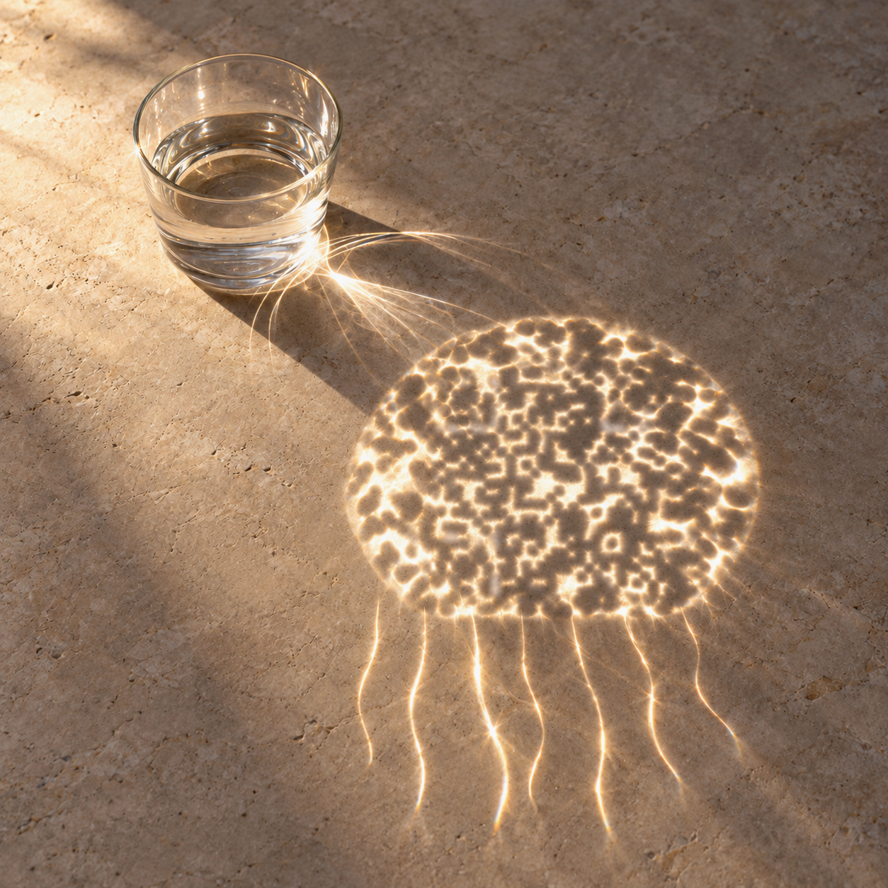
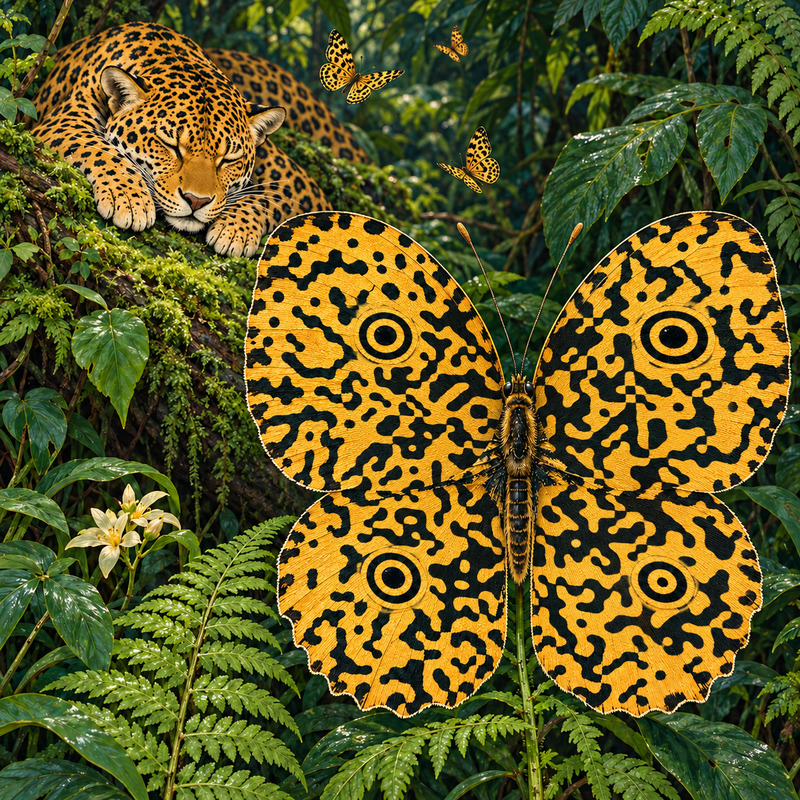
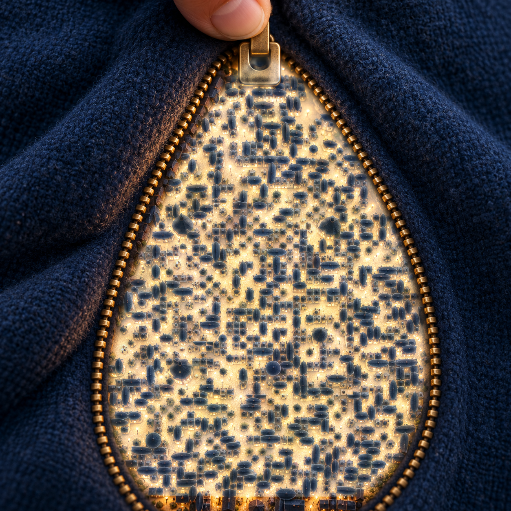
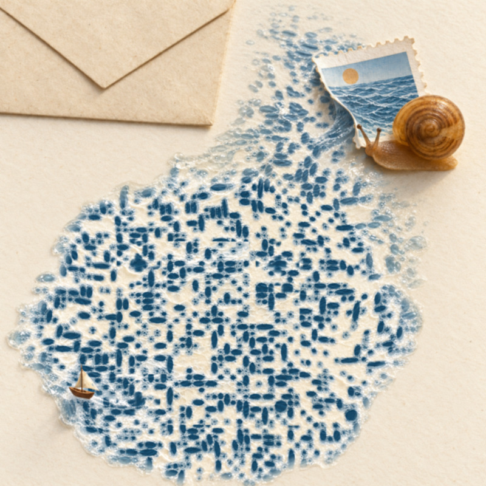
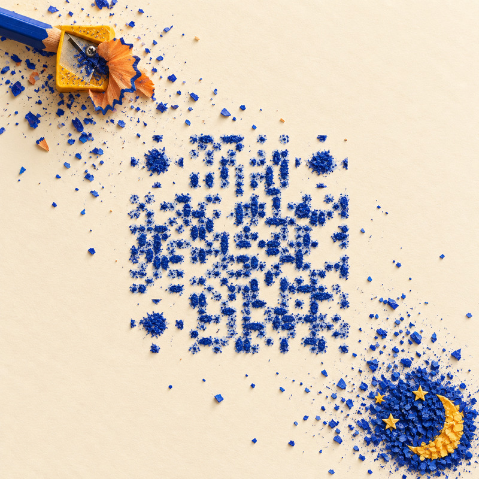
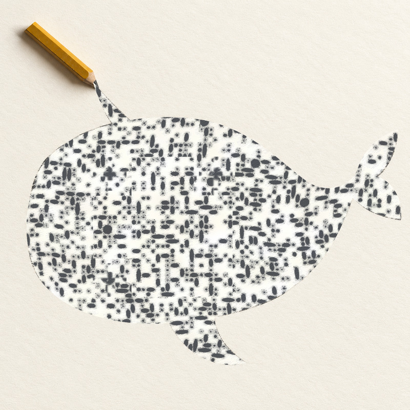
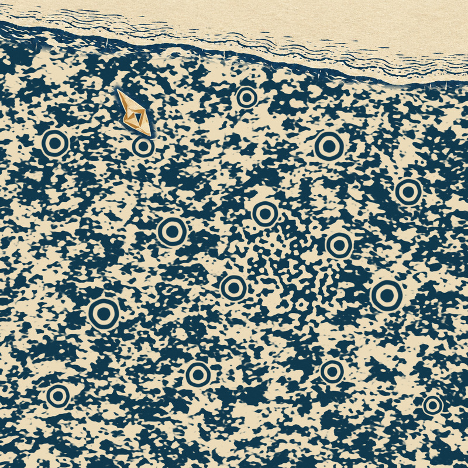
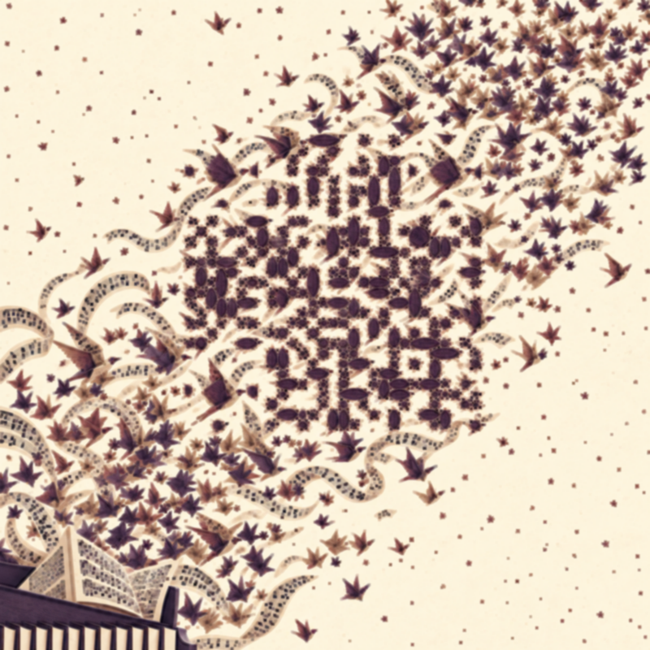

**English** · [简体中文](README.zh-CN.md)

# Make Creative QR

**Make the code part of the picture.**

An agent Skill for composing real QR content into photography, illustration and material-based artworks, then checking the complete image for readability.

[Get started](#use-the-skill) · [Read the Skill](skills/make-creative-qr/SKILL.md) · [All 14 works](examples/README.md)

## Selected work

Light, fabric, paper and carved marks carry the same information. Open an image for its story and complete original.

<p align="center">
  <a href="examples/README.md#caustic-jelly"></a>
</p>
<p align="center">
  <strong>Jellyfish of light</strong><br>
  <sub>Refracted light becomes a jellyfish on the tabletop.</sub>
</p>

<br>

<p align="center">
  <a href="examples/README.md#jaguar-butterfly"></a>
</p>
<p align="center">
  <strong>Jaguar butterfly</strong><br>
  <sub>Spots pass from a sleeping jaguar into a butterfly's wings.</sub>
</p>

<br>

<p align="center">
  <a href="examples/README.md#zipper-city"></a>
</p>
<p align="center">
  <strong>Zipper city</strong><br>
  <sub>An open zipper reveals a city glowing in the lining.</sub>
</p>

<br>

<p align="center">
  <a href="examples/README.md#stamp-sea"></a>
</p>
<p align="center">
  <strong>A sea in a stamp</strong><br>
  <sub>A snail draws the sea out of a postage stamp.</sub>
</p>

<br>

<p align="center">
  <a href="examples/README.md#shaved-night"></a>
</p>
<p align="center">
  <strong>Shavings of night</strong><br>
  <sub>Blue pencil shavings scatter into a piece of night.</sub>
</p>

<br>

<p align="center">
  <a href="examples/README.md#pencil-whale"></a>
</p>
<p align="center">
  <strong>A whale's shadow</strong><br>
  <sub>A pencil's shadow takes the shape of a swimming whale.</sub>
</p>

<br>

<p align="center">
  <a href="examples/README.md#rain-letter"></a>
</p>
<p align="center">
  <strong>Rain writes back</strong><br>
  <sub>Rain rings unfold around a paper boat in indigo print.</sub>
</p>

<br>

<p align="center">
  <a href="examples/README.md#flying-score"></a>
</p>
<p align="center">
  <strong>The score takes flight</strong><br>
  <sub>A piano score breaks into a flock of birds.</sub>
</p>

[Explore all 14 works →](examples/README.md) · [Decoding and phone-scan records](examples/verification.json)

Public works point to this repository. Software checks and phone scans are recorded per image; works without phone evidence remain pending review.

## Use the Skill

Import the [Skill directory](skills/make-creative-qr/) into an agent that supports directory-based Skills, or provide [SKILL.md](skills/make-creative-qr/SKILL.md) as instructions. Upload a real QR image, then ask:

```text
Use make-creative-qr to create an artwork with a naturally integrated QR code.
First confirm my style, elements and intended use. Preserve the original
scanned content and check the complete artwork and sharing sizes.
```

Documentation defaults to English, with a complete [Chinese edition](skills/make-creative-qr/SKILL.zh-CN.md). Creation and delivery follow the user's language.

## Creative principles

- **Let the scene stand on its own.** Materials have an origin, density follows an idea, and the visual language continues through the encoded area.
- **Keep the original content.** Preserve the scanned bytes without replacing, shortening or rewriting them.
- **Verify the finished image.** Check the actual file and sharing variants. Record software decoding and phone scans separately; a failed phone scan requires revision.

<details>
<summary>Tools, verification and content boundaries</summary>

The Skill defines capabilities and acceptance criteria; the agent uses tools available in its host. The bundled Python/Node scripts are one optional implementation. Creation requires image viewing and generation, reliable decoding, export and file-integrity checks. Without real decoding or required exports, outputs remain design candidates.

The default software profile has seven checks: the actual complete file, plus PNG and quality-85 JPEG variants at widths of 480, 640 and 800 pixels. Each must recover the original content without conflicts. Crops, supplied corner coordinates and pure-code mode cannot replace complete-image verification. Bind evidence to a content digest or file hash and recheck after editing or export. Software success cannot establish a phone app scan.

Confirm style, elements and use before creation; build information guidance and revise using visual and decoding feedback. Photography, illustration, anime, geometry and collage can all carry information. Non-ASCII or binary content needs reliable original-byte evidence; do not generate replacement encoding when the input cannot be confirmed.

Private source codes, payload data, artworks and recognition records stay out of public examples, reusable assets and test fixtures. Decoding runs in the host environment; generation and storage depend on the chosen services. This project does not promise an entirely offline workflow.

[Tool adaptation](skills/make-creative-qr/references/tool-adaptation.md) · [Optional reference implementation](skills/make-creative-qr/references/execution.md)

</details>

---

[Contributing](CONTRIBUTING.md) · [Privacy and security](SECURITY.md) · [Third-party notices](docs/THIRD_PARTY_NOTICES.md)

Code and documentation use the [MIT License](LICENSE). Artwork and third-party asset licensing are specified separately.
