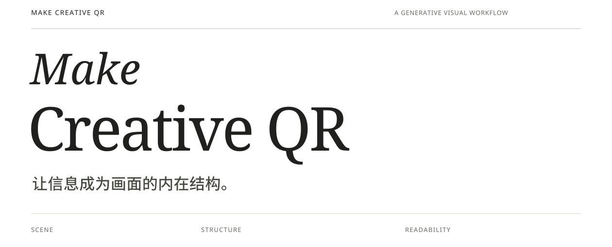
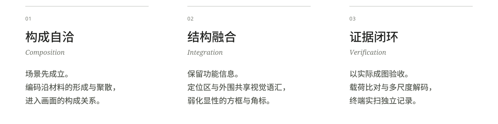

[English](README.md) | **简体中文**



**面向生成式视觉创作的场景融合式编码工作流。**

Make Creative QR 围绕真实二维码载荷，协同组织材料构成、信息映射与解码反馈。主协议描述所需能力与验收结果，具体工具由所在 Agent 适配；编码进入画面内部的形成与分布关系，可读性由实际成图的验证证据维护。

它关注图像的语义完整性：材料有来历，疏密有依据，场景有独立成立的逻辑。照片、二维插画、动漫、几何与拼贴，都可以成为信息的视觉载体。

## 创意案例

拉开的衣服里是一座亮灯的小城，铅笔的影子变成鲸鱼，邮票里的海流到桌面。信息由画面中的材料与明暗关系承载。

<a href="examples/README.zh-CN.md"></a>

[浏览全部 10 张案例 →](examples/README.zh-CN.md) · [文件与验证记录](examples/verification.json)

实际上传文件与六个分享变体均通过软件验码，统一指向本仓库。手机实扫状态逐图标注，尚未实测的作品保留为待复核。

[新增：唱片里升起了山脉 →](examples/README.zh-CN.md#record-mountains)

## 设计立场



自然感来自区内外连续的材料关系。功能信息需要保留，显性的定位方框、三个独有角标与突兀的信息边界需要融入构成。新的创意应改变形成机制与分布关系，让不同作品拥有各自的视觉逻辑。

## 从载荷到场景

**意图定义 → 载荷锁定 → 信息映射 → 视觉生成 → 反馈验收**

首次制作先确认风格、元素与用途。原始字节建立编码基线，材料行为决定构成，技术导引约束信息的位置与明暗关系。工作流通过能力映射（Capability Mapping）组织读码、信息导引、图像编辑、导出与验证，使用当前宿主实际提供的工具，依据视觉审查和解码结果持续修订。

<details>
<summary><strong>技术构成与执行边界</strong></summary>

- **内容保真：** 以原始 payload 为基准，精确比对解码字节，不擅自改写、缩短或替换内容。
- **信息导引：** 使用当前宿主的编码、图层、遮罩、节点或其他可用能力，建立保留原始内容与必要功能信息的视觉约束。
- **解码反馈：** 选用宿主可用的真实解码能力，记录逐项内容匹配与冲突；有多个独立实现时交叉检查。
- **文件完整性：** 用内容摘要、文件哈希或经宿主保证的不可变资产版本绑定实际作品；修改或重新导出后重新验收。

附带的 Python/Node 脚本是一条可选参考路线，使用 Segno、ZXing-C++、WeChatCV 与 SHA-256 等实现相应能力；其他宿主可用达到同等结果的工具。

这是创作与验收协议，生成结果需要迭代。非 ASCII 或二进制内容需要可靠的原始字节证据；无法确认输入内容时不生成替代编码。

</details>

## 可读性是交付条件

视觉自然与载荷一致须同时成立。验收对象为实际完整成图；导引图、局部裁剪或单个尺寸的成功，均不能批准作品交付。

默认手机分享场景执行 **七项软件测试**：实际完整文件，加上 480、640、800 像素宽的 PNG 与 JPEG 85 变体。每项须读取原始内容，且无冲突。软件解码与手机实扫分别记录；手机扫描失败则退回修订。

<details>
<summary><strong>查看完整验证要求</strong></summary>

- 完整文件与每个预定变体，至少由一个引擎读出与原码一致的字节。
- 实际文件不能通过放大补足测试尺寸，失败后不能削减必测项。
- 裁剪、已知四角辅助识别和纯码模式不作为成图验收证据。
- 用当前可用能力完成逐项验码和交付版本复核。选用附带脚本时，分别由 `qualify` 与 `check_delivery.py` 执行。
- 软件库或识别 API 的成功不能替代手机应用实扫。
- 未实扫的作品标注待手机复核；手机状态不能通过修改软件报告代替。
- 显示尺度、压缩、反光、拍摄距离与扫描应用会影响识别表现。

</details>

## 开始一次创作

上传真实二维码，调用 Skill：

```text
按照 make-creative-qr 的创作协议，创作一张场景融合式二维码。
请先与我确认风格、元素和用途，再设计具体的形成机制。
最终成图须保留原始扫码内容，并完成视觉与解码验收。
```

文档默认显示英文，顶部可切换完整中文版；[Skill 中文正文](skills/make-creative-qr/SKILL.zh-CN.md)也可直接阅读。实际创作时按用户的语言交流，不要求使用英文。

<details>
<summary><strong>安装与环境能力</strong></summary>

将 SKILL.md 或完整技能目录交给能读取这些指令的 Agent。核心协议可单独提供，具体工具调用遵循宿主的格式与权限；辅助参考和脚本按需使用。

宿主需具备图片查看与创作、可靠读码、预定导出和验证能力。缺少真实验码或必测导出时可继续做设计候选，但不能标记为已验证可扫码成品。

完整目录为 `skills/make-creative-qr/`。支持目录型 Skill 的宿主按自身机制导入；以文本上下文使用时，提供 SKILL.md 并要求按协议执行。产品专属元数据仅供对应宿主读取。

工具选择见 [宿主适配](skills/make-creative-qr/references/tool-adaptation.zh-CN.md)。仅选择附带代码路线时，Python/Node 依赖与命令见 [可选参考实现](skills/make-creative-qr/references/execution.zh-CN.md)。

</details>

## 公开展示与内容边界

用户创作保留原始内容。私人原码、编码资料、成图与识别记录不进入通用资产、公开案例或测试夹具。

项目展示作品统一指向 [GitHub 仓库主页](https://github.com/o381/make-creative-qr)，并以该地址重新编码、制作和验收。展示作品已加入[案例画廊](examples/README.zh-CN.md)，软件验证与手机复核状态分别记录，未实扫者不标记为手机验证通过。

解码与检查在宿主环境内运行，图片生成和存储由所使用的服务负责；本项目不承诺端到端离线处理。

---

[贡献指南](CONTRIBUTING.zh-CN.md) · [隐私与安全](SECURITY.zh-CN.md) · [执行文档](skills/make-creative-qr/references/execution.zh-CN.md)

原创代码与文档采用 [MIT 许可](LICENSE)。第三方依赖及字体保留各自许可，见 [第三方说明](docs/THIRD_PARTY_NOTICES.zh-CN.md)；后续展示作品的许可随具体资产说明。
