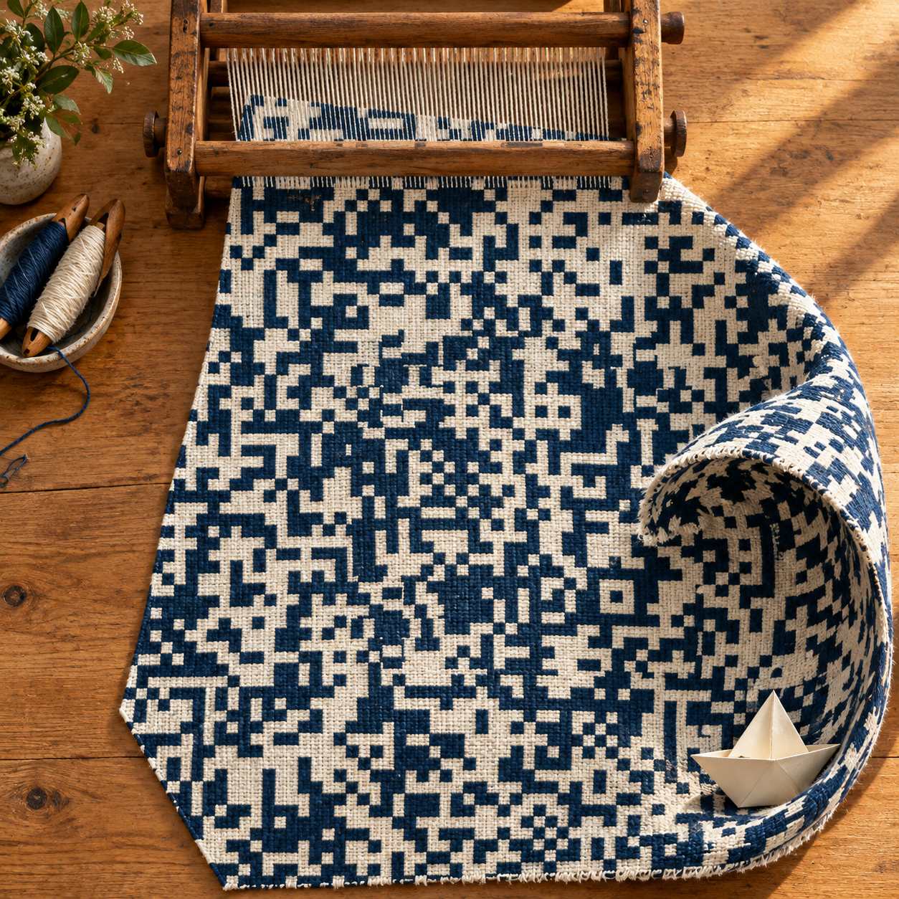
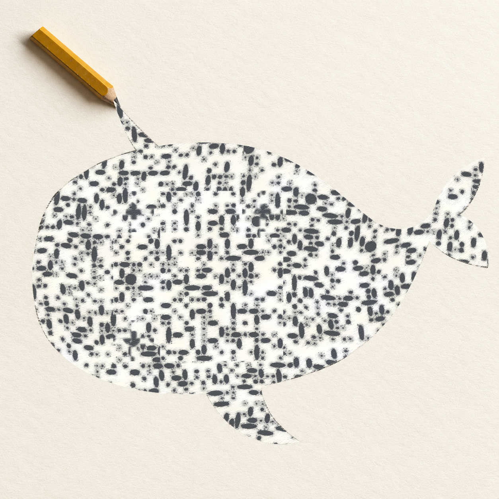
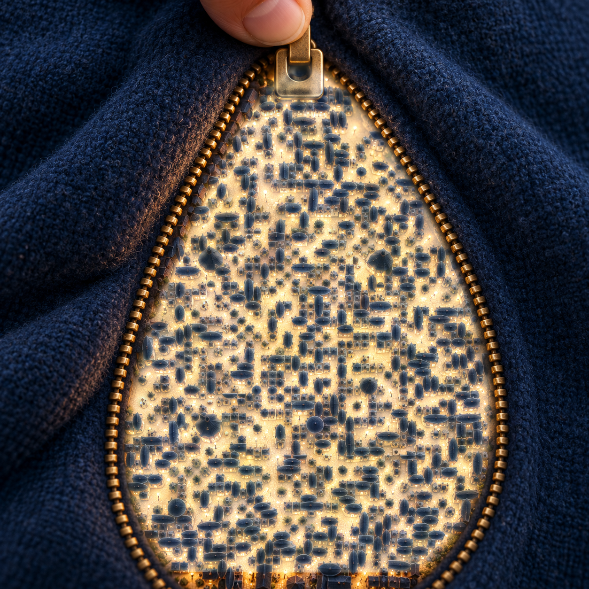
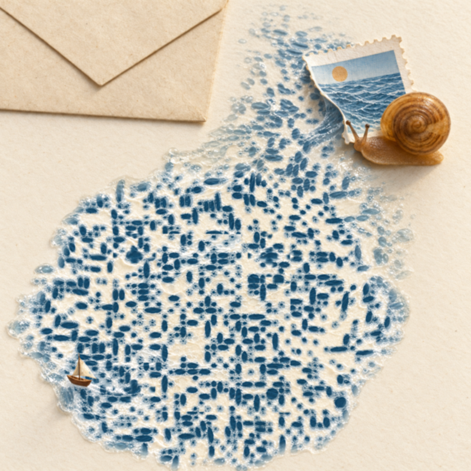
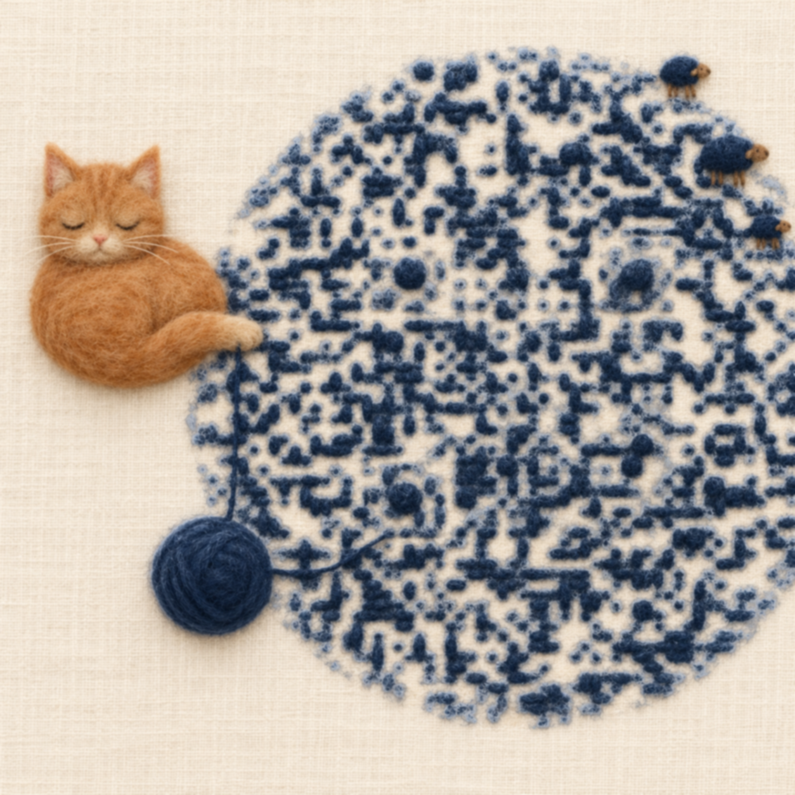
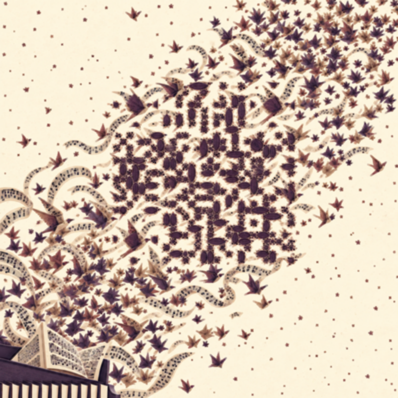
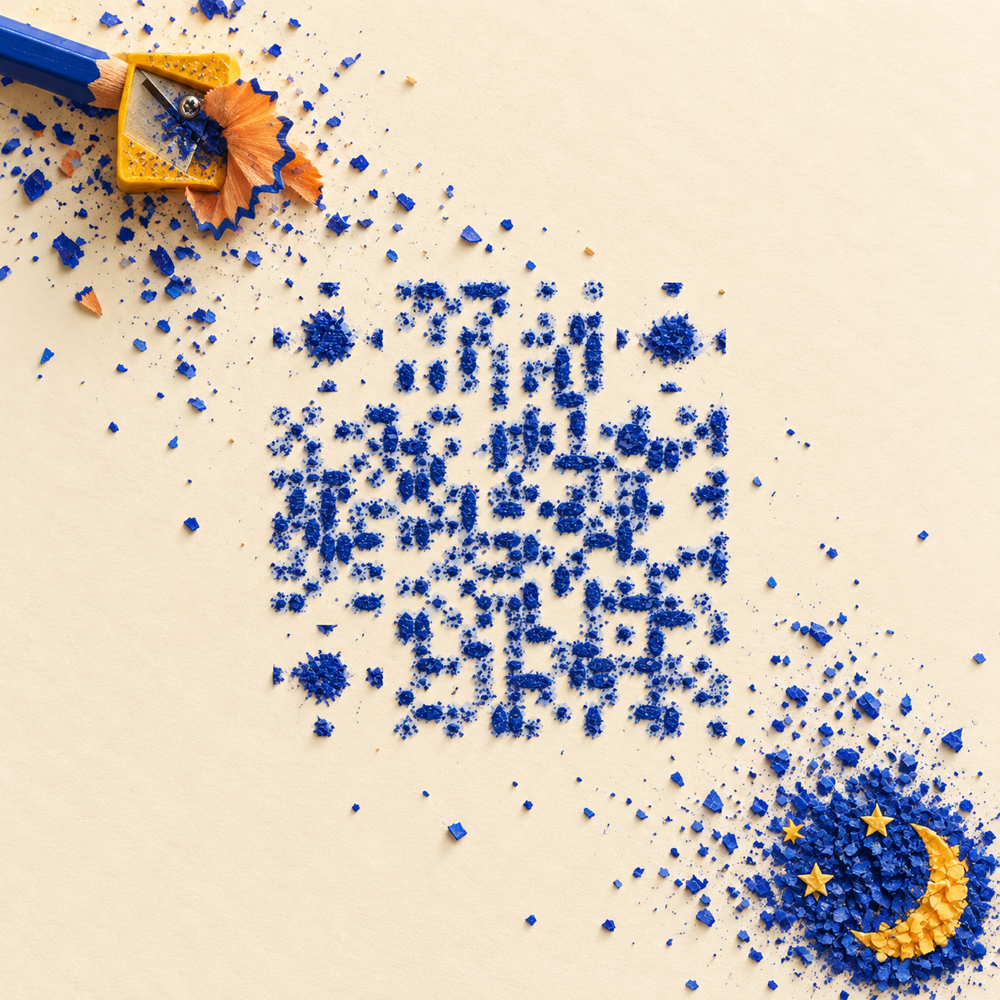
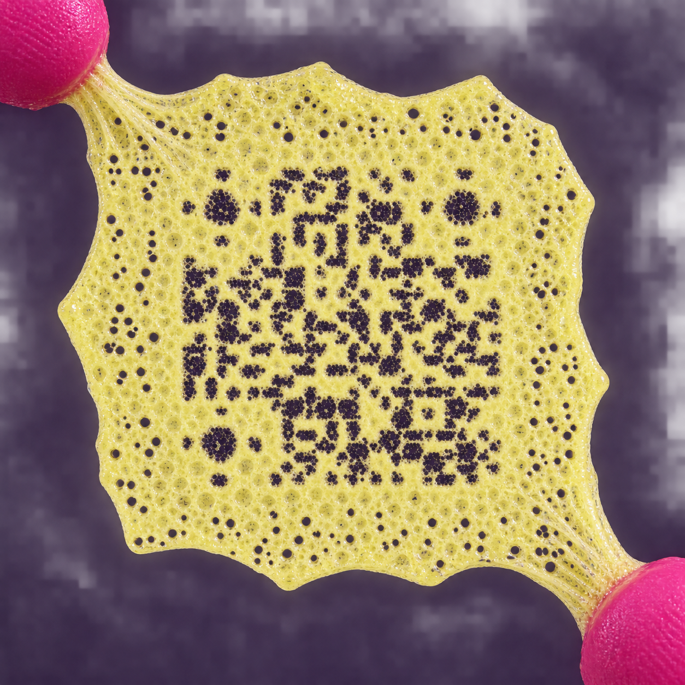
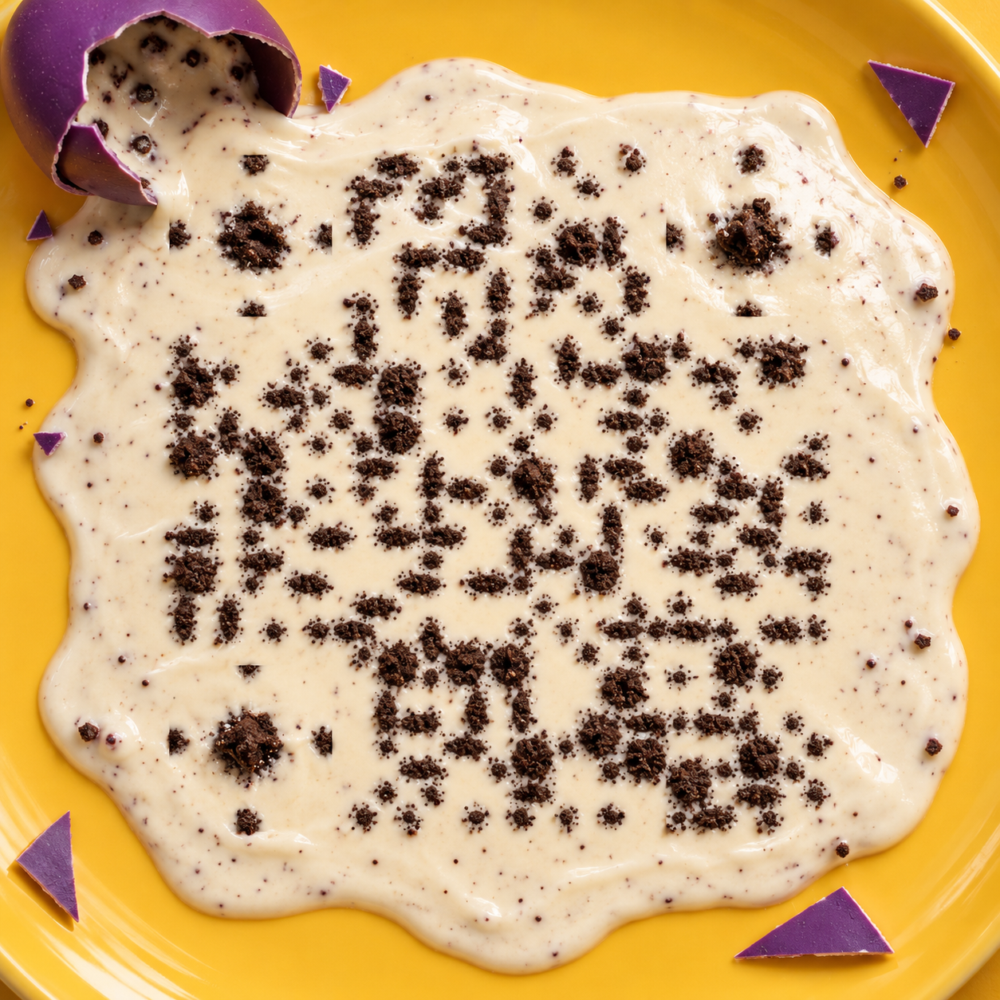

**English** | [简体中文](README.zh-CN.md)

# Creative QR gallery

Every artwork encodes the [make-creative-qr GitHub homepage](https://github.com/o381/make-creative-qr). Click an image to open the complete original file.

These nine works were published at the project owner's request: the first eight on 2026-10-16, followed by “A sea still on the loom” on 2026-10-17. Each actual uploaded file and its PNG and quality-85 JPEG variants at widths of 480, 640 and 800 pixels passed software decoding checks. Phone scan evidence is listed separately below.

| Artwork | Phone scan status |
| --- | --- |
| [A sea still on the loom](#loom-sea) | Pending phone review |
| [A pencil's shadow becomes a whale](#pencil-whale) | Pending phone review |
| [A city inside a zipper](#zipper-city) | Pending phone review |
| [A snail steals the sea from a stamp](#stamp-sea) | Pending phone review |
| [A ball of yarn becomes lambs](#wool-lambs) | Pending phone review |
| [After the score takes flight](#flying-score) | Pending phone review |
| [Shavings of night](#shaved-night) | Pending phone review |
| [Stretched yellow film](#stretched-film) | Pending phone review |
| [A cream-filled egg cracks open](#cream-egg) | User confirmed that the project page opened |

## A sea still on the loom

Indigo and ecru cotton curls into a wave while still on the loom. The continuous jacquard weave carries the information; a paper boat rests in its trough.

## A pencil's shadow becomes a whale

A pencil casts a swimming whale's shadow; graphite lines and unmarked paper carry the information.

## A city inside a zipper

An open zipper reveals a glowing city in the lining. Rooftops and alleys become information-bearing details.

## A snail steals the sea from a stamp

A snail lifts a postage stamp, letting its printed sea flow onto the desk as a miniature ocean.

## A ball of yarn becomes lambs

A cat pulls at yarn, and continuous felted-wool textures disperse into little lambs.

## After the score takes flight

A printed score turns into birds; ink marks and unmarked paper shape the composition together.

## Shavings of night

Curled pencil shavings meet the night, with the material's deformation carrying information.

## Stretched yellow film

Fingers stretch a thin film; the resulting pores and gaps carry information together.

## A cream-filled egg cracks open

Cream flows from a broken egg, with fragments, cracks and outer edges all participating in the same event.

## Files and verification

[Per-image file hashes and software verification records](verification.json). Passing software decoding does not guarantee success in every phone app or camera condition. Incomplete phone reviews remain pending.

The examples were made with generative tools, with optical, material or texture adjustments as needed. The repository's MIT License covers code and documentation; artwork licensing has not been separately specified.
