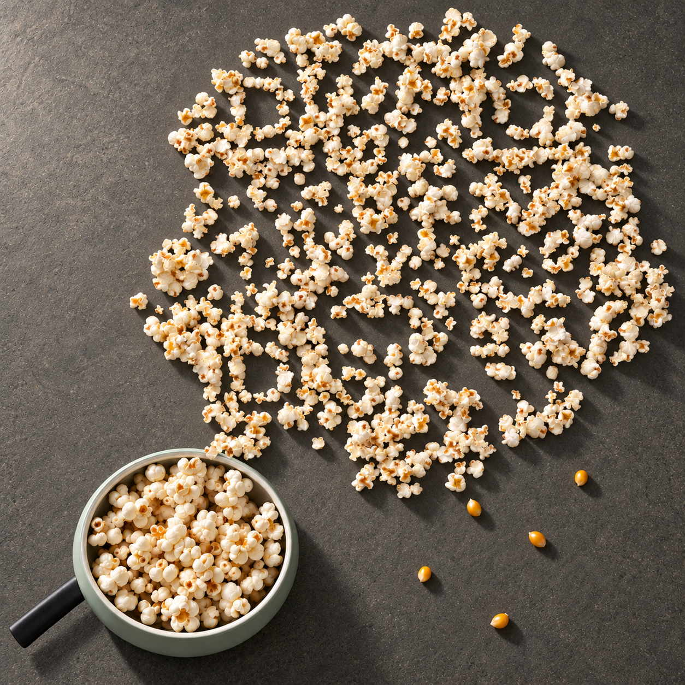
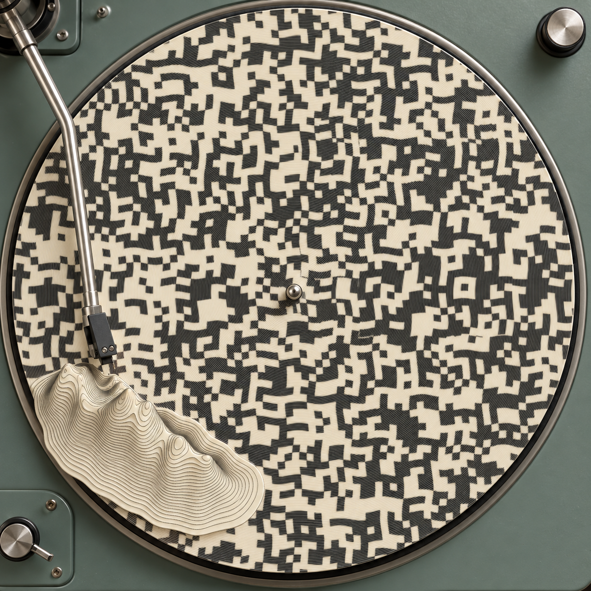

[English](README.md) | **简体中文**

# 创意二维码案例

每张图都扫描到 [make-creative-qr 的 GitHub 主页](https://github.com/o381/make-creative-qr)。点击图片查看完整原文件。

这 11 张作品按项目所有者要求公开：前 8 张于 2026-10-16 发布，另 2 张于 2026-10-17 加入，《锅里正在酝酿一场雨》于 2026-10-18 加入。所有实际上传文件及宽 480、640、800 像素的 PNG、JPEG 85 版本均通过软件验码；手机实扫状态单独列于下表。

| 作品 | 手机实扫状态 |
| --- | --- |
| [锅里正在酝酿一场雨](#popcorn-weather) | 待复核 |
| [唱片里升起了山脉](#record-mountains) | 待复核 |
| [织到一半的海](#loom-sea) | 待复核 |
| [铅笔的影子游成了鲸](#pencil-whale) | 待复核 |
| [拉链里藏着一座城](#zipper-city) | 待复核 |
| [蜗牛偷走邮票里的海](#stamp-sea) | 待复核 |
| [毛线球散成了小羊](#wool-lambs) | 待复核 |
| [乐谱飞走之后](#flying-score) | 待复核 |
| [削下的夜色](#shaved-night) | 待复核 |
| [黄膜拉伸](#stretched-film) | 待复核 |
| [破壳奶油彩蛋](#cream-egg) | 用户已确认打开项目页面 |

## 锅里正在酝酿一场雨

桌上的爆米花聚成一团云，金色玉米粒成为雨滴。完整颗粒与空隙共同承载信息，定向光和接触投影表现它们与桌面的关系。

## 唱片里升起了山脉

象牙白艺术唱片外缘的沟槽抬起，形成相连的层叠山脊；整张唱片的连续刻线承载信息，唱针停在山脚旁。

## 织到一半的海

织机上未完成的蓝白棉布卷成一道海浪，连续的经纬提花纹样承载信息，纸船停在布浪低处。

## 铅笔的影子游成了鲸

铅笔投下会游动的鲸影，石墨刻线与纸面留白承载信息。

## 拉链里藏着一座城

拉开衣服，内衬里藏着亮灯的小城；屋顶与巷道成为信息细节。

## 蜗牛偷走邮票里的海

蜗牛牵起邮票，印刷的海流到桌面，成为一片微型海域。

## 毛线球散成了小羊

猫咪牵动毛线，连续的羊毛毡纹理散成了几只小羊。

## 乐谱飞走之后

纸上的乐谱化成飞鸟，印刷痕迹与纸面留白共同构成画面。

## 削下的夜色

削笔留下的卷屑与夜色相连，材料的形变承载信息。

## 黄膜拉伸

手指拉开一层薄膜，受力后的细孔和材料间隙共同承载信息。

## 破壳奶油彩蛋

彩蛋碎壳中流出奶油，碎屑、裂口和外缘共同参与同一事件。

## 文件与验证

[逐图文件摘要与软件验证记录](verification.json)。软件识别通过不代表每个手机应用和拍摄条件均能成功；尚未完成的手机复核保持为待复核。

示例图由生成式工具辅助创作，并按各自需要做光学、材质或纹理处理。代码与文档采用仓库 MIT 许可；图片许可尚未另行指定。
